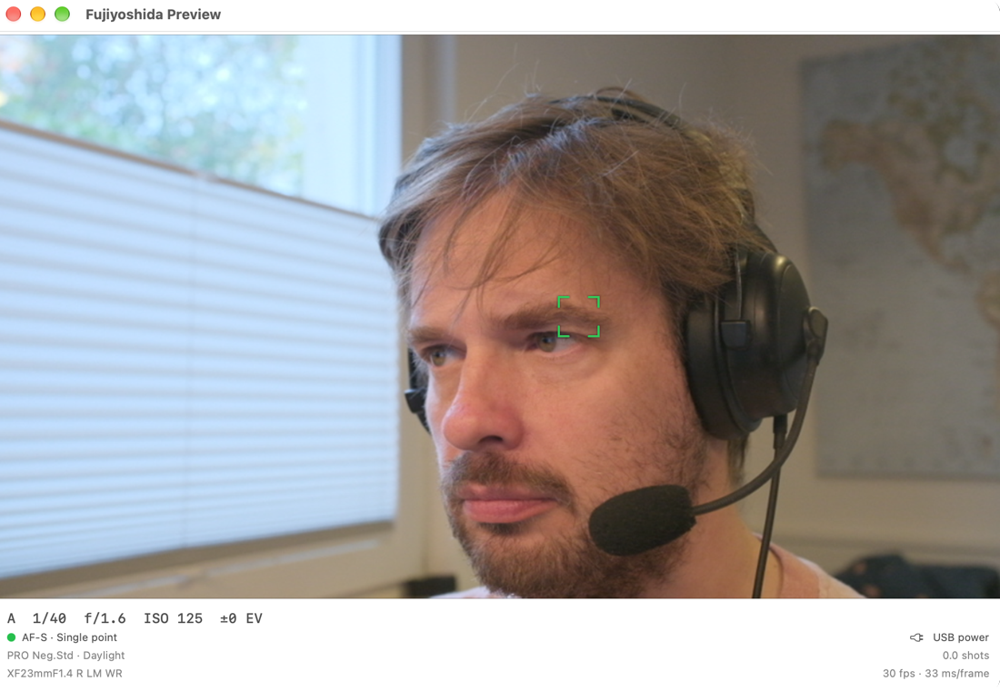
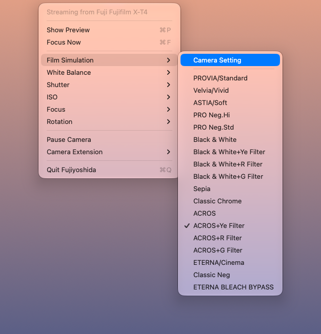
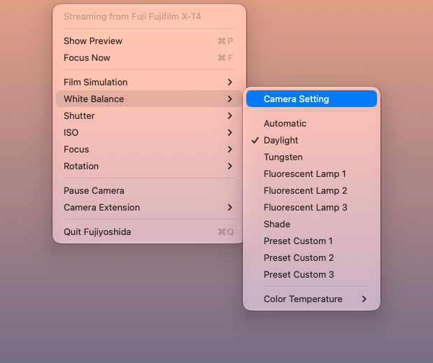
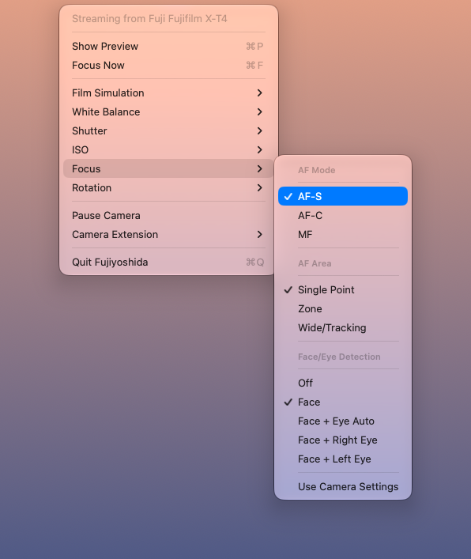
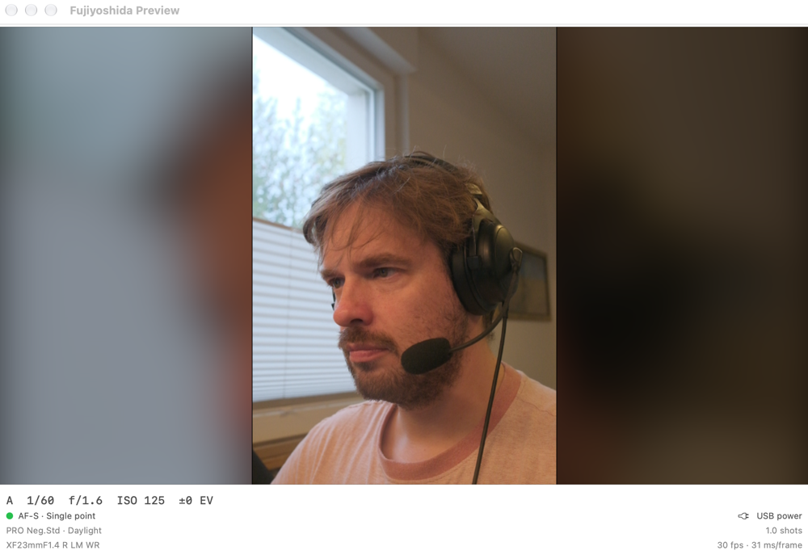
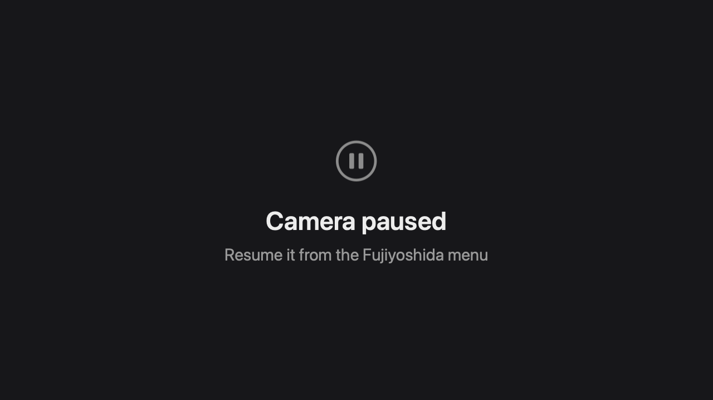

<p align="center">
  
</p>

<h1 align="center">Fujiyoshida</h1>

<p align="center">Use a Fujifilm X-T4 as a macOS webcam – at the camera's full 30 fps, with its film simulations, autofocus and face detection.</p>

<p align="center">
  
</p>

Fujifilm's own webcam software for the Mac is no longer maintained. Fujiyoshida is a small, self-built replacement: a menu-bar app that reads the camera's USB live view and a camera extension that shows up as **Fujiyoshida X-T4** in FaceTime, Zoom, Teams, Meet, OBS and every other video app.

## How it works

```
X-T4 ──USB──▶ Fujiyoshida.app ──frames──▶ Camera extension ──▶ your video app
              (libgphoto2, settings,       (CoreMediaIO,
               preview, menu bar)           "Fujiyoshida X-T4")
```

- **Fujiyoshida.app** talks to the camera through a bundled, slightly patched [libgphoto2](https://github.com/gphoto/libgphoto2), decodes the live view (1024×768 JPEG at ~30 fps) and crops it to 1280×720.
- **The camera extension** is a CoreMediaIO system extension. The app feeds it frames, and it serves them to any app that opens the camera.
- **The camera only runs while it's needed.** As long as no app uses Fujiyoshida X-T4 and the preview is closed, the app lets go of the camera – no live view, less heat, less battery drain. Opening the camera in a video app starts it again within about a second.

## Features

### Camera controls in the menu bar

<p>
  
</p>

- **Film simulations** – all of the camera's looks, from PROVIA and Classic Chrome to ACROS and ETERNA, applied in the camera itself.
- **White balance** – presets, custom presets or a colour temperature.
- **Shutter and ISO** – including 1/60 s, twice the frame rate, for natural motion blur. The shutter dial has to be on **T** and the ISO dial on **A**.
- **Your choices stick.** They are applied every time the camera connects, and the camera gets its own settings back when Fujiyoshida lets go of it. "Camera Setting" leaves a value alone.

<p>
  
  
</p>

### Focus

- **Focus Now** (⌘F) triggers the autofocus.
- **AF mode** (AF-S, AF-C, MF), **AF area** (single point, zone, wide/tracking) and **face/eye detection** from the Focus menu.
- **Click to focus** – click anywhere in the preview to move the focus point. The camera's joystick is locked while it is tethered, so this is the way to pick a spot.

### Preview window

**Show Preview** (⌘P) opens a small floating window that shows what the camera sees, with:

- the current **focus point** and the **faces** the camera detects, drawn the way the camera draws them,
- exposure (mode, shutter, aperture, ISO, exposure compensation), AF mode and status, film simulation, white balance, lens,
- **battery**, or *USB power* / *Charging* when the camera runs on its cable,
- frame rate and camera latency.

Right-click the preview for the same camera controls as in the menu.

### Portrait mode



Mount the camera on its side and pick **Rotation › Portrait**. The upright picture is centred over a soft, blurred fill instead of being cropped to a sliver. The X-T4 doesn't tell the computer which way it's held, so this is set by hand.

### Status at a glance



- **In the video:** when there is no picture, the video says why – no camera connected, camera not sending live view, or paused – so the people on your call aren't left looking at a frozen frame.
- **In the menu bar:** the icon shows the state: streaming, starting, standby, no camera, needs attention, paused. Below 20 % battery it turns into a battery warning with the percentage.
- **Pause Camera** stops the camera without quitting the app.

## Camera setup (X-T4)

1. `MENU › SET UP › CONNECTION SETTING › PC CONNECTION MODE` → **USB TETHER SHOOTING AUTO**
2. STILL/MOVIE lever (under the shutter dial) on **STILL**, drive mode on a still mode (e.g. S). In movie mode the camera hides most properties over USB and refuses live view.
3. Close camera menus and playback; the camera answers "busy" while they are open.
4. Set auto power-off to OFF and preferably power the camera via USB-C PD or a dummy battery.
5. Connect via USB-C.

## Build & install

Requires Xcode signed in with your Apple Developer account (Xcode › Settings › Accounts) and Homebrew.

```sh
./scripts/install.sh
```

The script builds a patched libgphoto2 into `vendor/`, builds and signs the app, and installs it to `/Applications`. On first launch, approve the extension in **System Settings › General › Login Items & Extensions › Camera Extensions**, then pick **Fujiyoshida X-T4** as the camera in your video app. Fujiyoshida.app must be running for live video.

The libgphoto2 patch (`scripts/build-libgphoto2.sh`) extends its raw `opcode` config: it returns the camera's response, can send property data and can stop live view. Fujiyoshida needs this for the focus point (`0xD347`/`0xD395`), face frames (`0xD18A`) and for applying settings. After the patch changes, rebuild with `FORCE=1 ./scripts/build-libgphoto2.sh`.

The app icon is generated by `swift scripts/make-icon.swift`.

## Notes

- **The camera only accepts settings while live view is stopped.** Fujiyoshida pauses live view for a fraction of a second while it applies a change.
- **After an update to the camera extension,** restart Fujiyoshida once if it keeps saying "Waiting for camera extension…".
- **macOS's `ptpcamerad` grabs PTP cameras;** Fujiyoshida stops it before connecting.
- **Quit Fujiyoshida via its menu** (or a normal `kill`). It closes the camera's live-view session on exit. A hard kill (`kill -9`) can leave the camera busy until it is switched off and on.
- **libgphoto2** (LGPL-2.1) and its dependencies are bundled into the app at build time (`scripts/bundle-gphoto2.sh`). Homebrew is only needed to build. See [Thanks](#thanks-libgphoto2) for details and licensing.
- **Not affiliated with Fujifilm.** Fujifilm, X-T4 and the film simulation names are trademarks of FUJIFILM Corporation.

## Thanks, libgphoto2

Fujiyoshida would not exist without **[libgphoto2](http://www.gphoto.org/)**, the free, open-source camera access library of the [gPhoto project](https://github.com/gphoto). For more than two decades its volunteers have reverse-engineered, documented and maintained support for thousands of cameras, sometimes one USB packet at a time. Everything Fujiyoshida does with the X-T4 builds on that work:

- the PTP/USB transport and Fujifilm vendor extensions,
- the 30 fps live view,
- the camera settings and their names,
- the property codes that made the focus point, face frames and battery readable.

If Fujiyoshida is useful to you, please consider supporting them:

- Star and contribute to [gphoto/libgphoto2](https://github.com/gphoto/libgphoto2) and [gphoto/gphoto2](https://github.com/gphoto/gphoto2).
- Report camera quirks and test results upstream; new camera support comes from people doing exactly that.
- Read more at [gphoto.org](http://www.gphoto.org/) and in the [libgphoto2 documentation](http://www.gphoto.org/doc/).

**Licensing.** libgphoto2 is licensed under the [GNU Lesser General Public License v2.1](https://github.com/gphoto/libgphoto2/blob/master/COPYING). Fujiyoshida links it dynamically and ships it inside the app bundle as separate libraries (`Contents/Frameworks/libgphoto2`).

- **Source and changes:** `scripts/build-libgphoto2.sh` downloads the unmodified [libgphoto2 2.5.34 release](https://github.com/gphoto/libgphoto2/releases/tag/v2.5.34) and applies Fujiyoshida's small patch in plain text, so the exact source of the bundled library can always be rebuilt from this repository.
- **Your own build:** you can replace the bundled libgphoto2 with your own build.
- **Upstream:** the patch only extends the generic `opcode` config; if it's useful upstream, it will be offered back.
